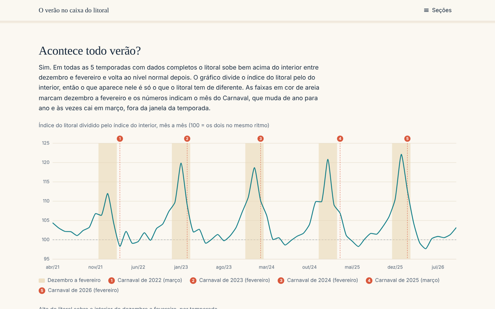
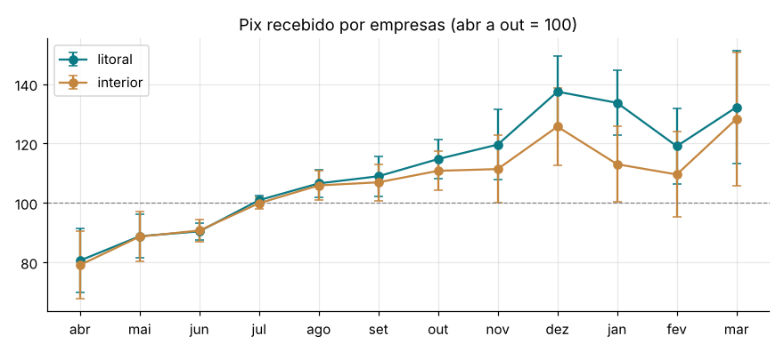
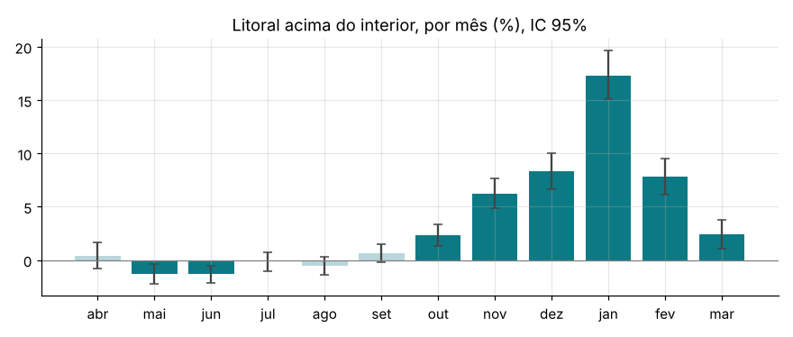
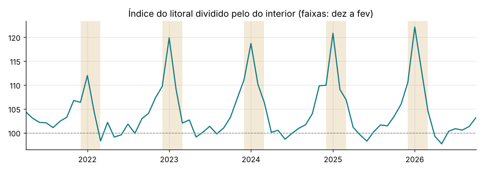
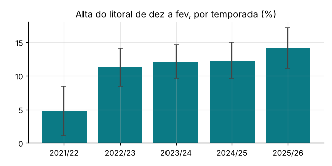
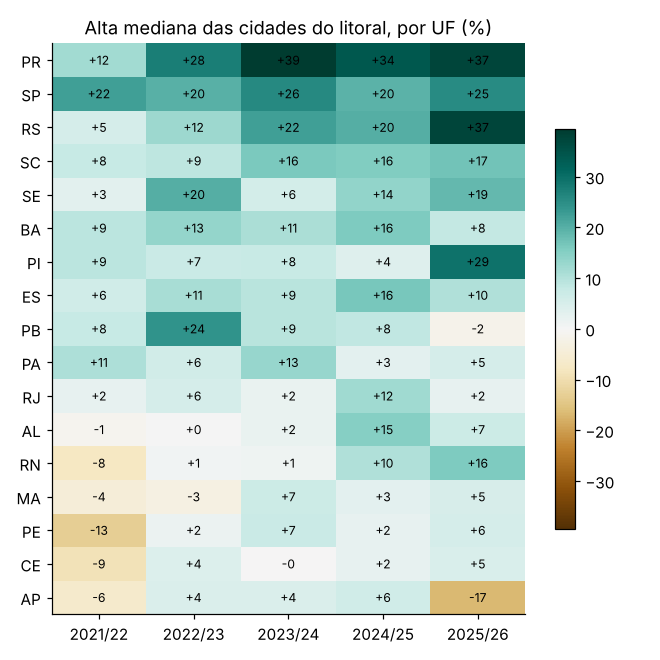
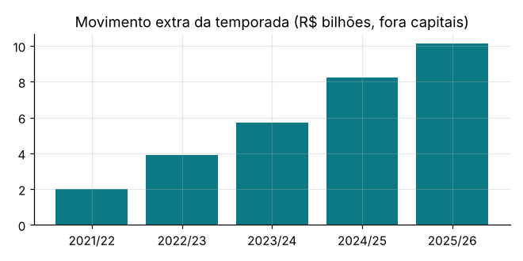

# O verão no caixa do litoral

[](https://github.com/oLucas-Passos/comercio-litoral-fim-de-ano/actions/workflows/ci.yml)


Quanto o comércio das cidades de frente para o mar recebe a mais entre dezembro e fevereiro? Não existe dado público de vendas por município, então usei o **Pix recebido por empresas em cada cidade** (Banco Central) como medida do movimento local. As contratações em supermercados (Novo CAGED) entram numa próxima versão, como segunda fonte. A comparação é entre as cidades defrontantes com o mar (lista do IBGE) e o resto do país, com um modelo de efeitos fixos que desconta o crescimento do Pix e o Natal, que acontecem em todo lugar.

**[Site](https://olucas-passos.github.io/comercio-litoral-fim-de-ano/)** | **[Notebook](notebooks/analise.ipynb)** | **[Resumo em JSON](data/processed/resumo.json)**



## Principais resultados

Dados de abril de 2021 a outubro de 2026, 5.567 municípios, 279 deles de frente para o mar.

| Pergunta | Resultado |
|---|---|
| Quanto o litoral sobe no verão? | De dezembro a fevereiro, o Pix recebido por empresas no litoral fica **+11,1%** acima do interior (IC 95%: +9,4% a +12,8%), já descontado o que é comum ao país |
| Em que mês? | Pico em **janeiro (+17,3%)**. Dezembro +8,3%, fevereiro +7,8%. A alta começa em novembro (+6,2%) e ainda sobra em março (+2,4%) |
| Acontece todo ano? | Sim, nas cinco temporadas. Subiu de +4,7% em 2021/22 para **+14,1% em 2025/26** |
| Quanto dinheiro a mais? | **R$ 10,1 bilhões** na temporada 2025/26, somando as cidades do litoral fora das capitais: 4,0% de tudo que receberam no período (R$ 252 bilhões) |
| Quem paga? | Em janeiro, o recebido pelas empresas fica 34% acima de um mês comum e o pago pelos moradores, 23%. Em dezembro os dois sobem juntos (Natal). No modelo, o pago por moradores sobe +4,1% contra +11,1% do recebido |
| Onde? | Maiores altas típicas: Bombinhas (SC) +80%, Arroio do Sal (RS) +55%, Cairu (BA) +48%, Imbé (RS) +46%, Ubatuba (SP) +45%. Nas capitais, a mediana é +1% |
| Por estado? | PR, SP, RS e SC no topo; Nordeste mais embaixo, onde o turismo de praia se espalha pelo ano |
| Robustez | Entre +8,5% e +12,2% em seis especificações alternativas (interior do mesmo estado, sem capitais, só cidades maiores, número de transações, sem 2021/22) |

<details>
<summary><b>Figuras do notebook</b></summary>

| | |
|---|---|
|  |  |
|  |  |
|  |  |

</details>


## Metodologia

**Medida.** `VL_RecebedorPJ`: valor total de Pix recebido por pessoas jurídicas com cadastro no município, por mês, corrigido pelo IPCA. Período a partir de abril de 2021, para deixar de fora os meses de adoção inicial do Pix (lançado em novembro de 2020). Cidades com algum mês sem valor recebido ficam fora do painel, porque o modelo usa logaritmo.

**Temporada e base.** Temporada `t/t+1` = dezembro de `t`, janeiro e fevereiro de `t+1`. A base é abril a outubro do ano `t`: sem férias de verão, sem Natal e sem 13º salário.

**Modelo principal.** Efeitos fixos de município e de mês, com interação entre litoral e mês do ano:

```
log y_it = a_i + g_t + soma_m b_m * 1[mês(t) = m] * litoral_i + e_it
```

`a_i` absorve o tamanho de cada cidade e `g_t` tudo que é comum ao país no mês `t` (crescimento do Pix, inflação, Natal). Os `b_m` são reportados contra a média de abril a outubro, com erros padrão agrupados por município. Os efeitos fixos são removidos por projeções alternadas, o que permite trocar `g_t` por efeitos UF x mês sem montar milhares de dummies.

**Por temporada.** Diferenças em diferenças com amostra restrita aos meses de temporada e de base, incluindo litoral x ano, para que cada temporada seja comparada com a base do próprio ano.

**Peso das cidades.** Perfis, índices e comparações com o interior usam média geométrica entre cidades, para que cada cidade conte igual (coerente com o modelo em log). Somando valores, as capitais decidiriam o resultado sozinhas.

**Alta e valor a mais por cidade.** Para a cidade `i` na temporada `t`:

```
alta_it        = [média(dez a fev) / média(abr a out)]_i / média geométrica da mesma razão no interior da UF - 1
alta_tipica_i  = mediana de alta_it nas temporadas
excesso_it     = 3 * média(dez a fev)_it * a / (1 + a),  a = alta_tipica_i
```

A mediana evita que um choque isolado (uma empresa grande que muda de endereço) apareça como efeito do verão. A soma do valor a mais deixa as capitais de fora: nelas o Pix recebido por empresas é dominado por pagamentos entre empresas.

**Supermercados (próxima versão).** Admissões e desligamentos do Novo CAGED (arquivos MOV) nas subclasses CNAE 4711-3/01, 4711-3/02 e 4712-1/00, agregados por município. Pico definido como novembro a janeiro, porque a contratação antecede o movimento. A relação com o Pix é medida pela correlação de Spearman entre a alta média de cada cidade nas duas fontes.

**Robustez.** O efeito médio de dezembro a fevereiro é reestimado comparando só com o interior do mesmo estado, sem as capitais, só com cidades com 100 empresas ou mais, com o número de transações no lugar do valor e sem a temporada 2021/22. Como controle, o mesmo modelo é aplicado ao Pix pago por pessoas físicas residentes: se a alta viesse dos moradores, ele também subiria.

### Limitações

- Pix não é faturamento: cartão e dinheiro ficam de fora, e a participação do Pix nas vendas mudou no período.
- O valor recebido inclui todos os setores (hospedagem, restaurantes, comércio). O CAGED isola os supermercados, mas mede emprego, não vendas.
- O município é o do cadastro da empresa; redes com CNPJ centralizado em outra cidade aparecem fora do litoral. Em cidades com porto ou indústria grande (Cabedelo, São Francisco do Sul, Goiana), o Pix das empresas reflete mais negócios entre empresas e cai no verão.
- Os dados do CAGED ainda não entraram nesta versão (o download é por FTP). O pipeline e o site já tratam esses dados quando o arquivo existe.
- Os resultados são associações. Os efeitos fixos removem o que é constante em cada cidade e o que é comum a cada mês, mas não diferenças de sazonalidade entre litoral e interior que não venham do verão.

## Arquitetura

```
src/litoral/
├── config.py          caminhos, calendário (temporada, base), CNAE, UFs
├── ingestao.py        leitura do Pix (BCB), CAGED, cadastro de municípios, lista do IBGE, IPCA
├── validacao.py       regras bloqueantes e avisos (chaves, cobertura, códigos, consistência)
├── transformacao.py   painel município x mês, deflação, ciclos e temporadas
├── metricas.py        perfis sazonais, efeitos fixos, diferenças em diferenças, índices por cidade
└── pipeline.py        orquestra tudo e exporta data/processed e data/litoral.json
scripts/               download dos dados brutos (API do BCB, FTP do MTE, IBGE)
tests/                 testes com dados sintéticos de efeito conhecido
index.html, css/, js/  site estático (Chart.js), publicado no GitHub Pages
```

**Testes.** Os dados sintéticos têm um efeito de verão injetado (+10% em dezembro, +40% em janeiro, +20% em fevereiro, com intensidade diferente em cada cidade) e um padrão de Natal comum a todas as cidades. Os testes verificam que o modelo recupera o efeito do litoral, absorve o padrão comum, não acha efeito no Pix pago por moradores, ordena as cidades pela intensidade injetada e que a correlação com o CAGED sintético é positiva.

## Como reproduzir

```bash
git clone https://github.com/oLucas-Passos/comercio-litoral-fim-de-ano.git
cd comercio-litoral-fim-de-ano
pip install -e ".[dev,notebook,download]"

make baixar      # IPCA, municípios, lista do IBGE, Pix por município e CAGED
make testes      # pytest + cobertura
make dados       # python -m litoral -> data/processed/ e data/litoral.json
make servir      # site em http://localhost:8000
```

O download do CAGED baixa um arquivo compactado por mês do FTP do Ministério do Trabalho e guarda só o agregado do varejo alimentar em `data/raw/caged_meses/`, então pode ser interrompido e retomado.

## Dados

| Arquivo | Fonte |
|---|---|
| `data/raw/pix/*.csv.gz` | [BCB, Estatísticas do Pix](https://dadosabertos.bcb.gov.br/dataset/pix): `TransacoesPixPorMunicipio` |
| `data/raw/caged_supermercados.csv` | [MTE, microdados do Novo CAGED](https://www.gov.br/trabalho-e-emprego/pt-br/assuntos/estatisticas-trabalho/microdados-rais-e-caged), varejo alimentar agregado por município |
| `data/raw/municipios_defrontantes_mar.csv` | [IBGE, Municípios defrontantes com o mar](https://www.ibge.gov.br/geociencias/organizacao-do-territorio/estrutura-territorial/24072-municipios-defrontantes-com-o-mar.html) |
| `data/raw/municipios.csv` | [kelvins/municipios-brasileiros](https://github.com/kelvins/municipios-brasileiros) (MIT): nome, UF e coordenadas da sede |
| `data/raw/ipca_bcb_433.csv` | [BCB, SGS 433](https://www3.bcb.gov.br/sgspub/): IPCA, variação mensal (%) |
| `data/processed/` | Painel, índices por cidade, valor a mais por temporada, coeficientes e `resumo.json` |

## Autor

**Lucas Passos** | [github.com/oLucas-Passos](https://github.com/oLucas-Passos)
